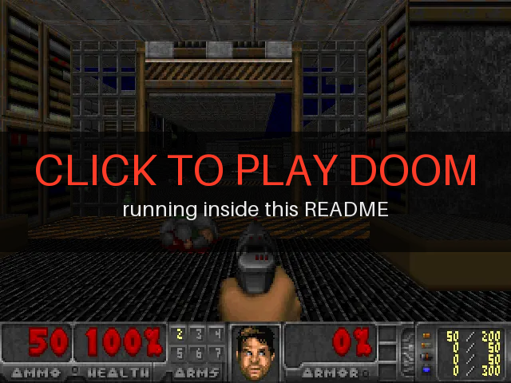

<h1 align="center">Doom, running inside a GitHub README</h1>

 
<strong>Yes, this is the game. Click the picture to start, then click the arrows.</strong>

---

## How to play

Every picture is a pre-rendered view of Freedoom's first level, E1M1. Each page links to the page for the
next view, so clicking an arrow "moves" you.

| Button | What it does |
|---|---|
| ⬆️ / ⬇️ | Walk forward / backward |
| ↖️ ↗️ ↙️ ↘️ | Sidestep diagonally while still facing the same way |
| ⬅️ / ➡️ | Turn 90 degrees in place |
| 💥 | Fire (nothing happens, except at the exit, where it ends the level) |
| faded arrow | A wall or a drop is in the way |

Find the exit room and fire at the switch to finish the level.

## What is this?

1,123 walkable spots x 4 facing directions = 4,492 screenshots, each with its own markdown page.
No JavaScript, no server: GitHub just renders static pages and links. The pages are in `game/`, the
screenshots in `assets/`.

## How it was built

1. `generator/mapdata.py` reads the level straight out of the Freedoom WAD, opens every door and lift,
   flood-fills the walkable floor (walls, step height and headroom respected) and links each spot to its
   neighbours in 8 directions.
2. `generator/capture.py` teleports a headless [ViZDoom](https://github.com/Farama-Foundation/ViZDoom)
   player to each spot and saves one WebP per facing angle.
3. `generator/linker.py` writes the interlinked markdown pages and this README.
4. `generator/record_demo.py` records the gameplay GIF at the top of the profile (`static/doom-demo.gif`): the
   shortest route to the exit with monsters on, auto-aiming the shotgun at every monster in view.
5. Rendering runs on a rented cloud box or GitHub Actions (`.github/workflows/render.yml`), not on a laptop.

## Credits and licenses

- Idea and original generator: [DoomMe](https://github.com/Kuberwastaken/DoomMe) by
  [Kuber Mehta](https://kuber.studio) (MIT). Write-up:
  [How I Made DOOM Run Inside a GitHub Readme](https://kuber.studio/blog/Projects/How-I-Made-DOOM-Run-Inside-a-GitHub-Readme).
  This project adapts his capture and linker scripts. His license notice is kept in [LICENSE](LICENSE).
- Game data and art: [Freedoom](https://freedoom.github.io) v0.13.0, BSD 3-clause
  ([license](licenses/FREEDOOM-COPYING.txt), [credits](licenses/FREEDOOM-CREDITS.txt)).
  **This repo does not use id Software's `doom1.wad` or any id Software art.**
- Engine for rendering: [ViZDoom](https://github.com/Farama-Foundation/ViZDoom) (built on ZDoom).
- Code in this repo: MIT, see [LICENSE](LICENSE).
